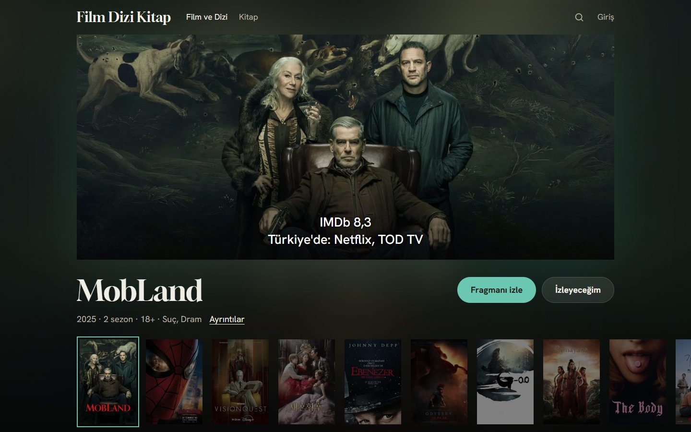
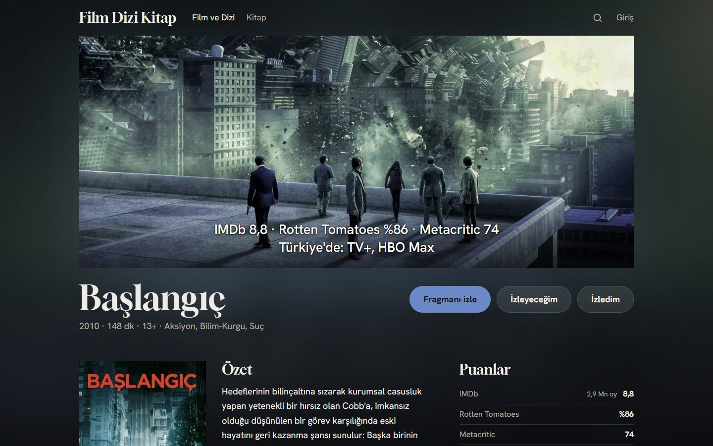
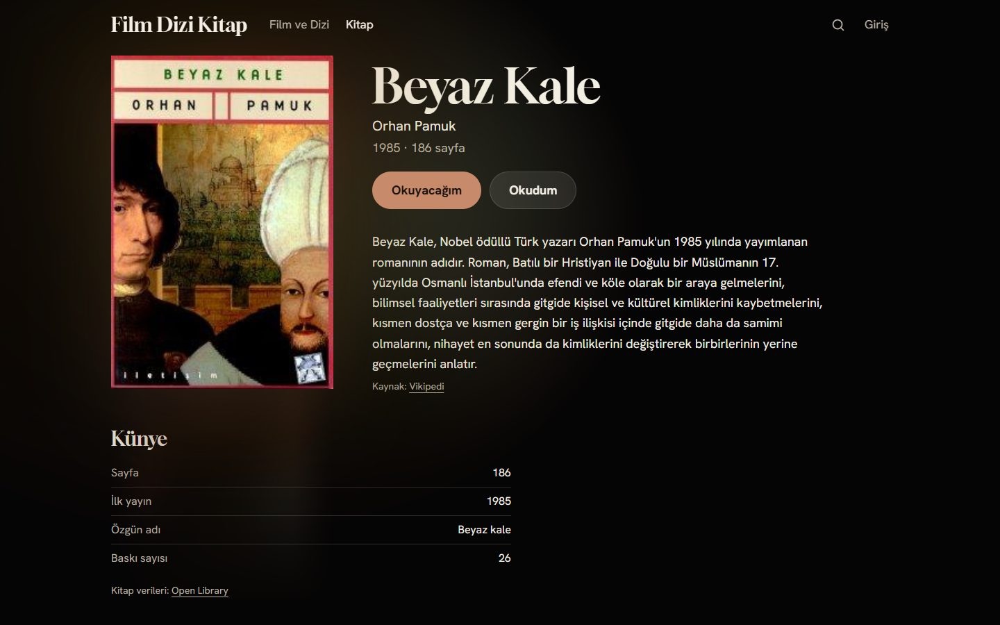
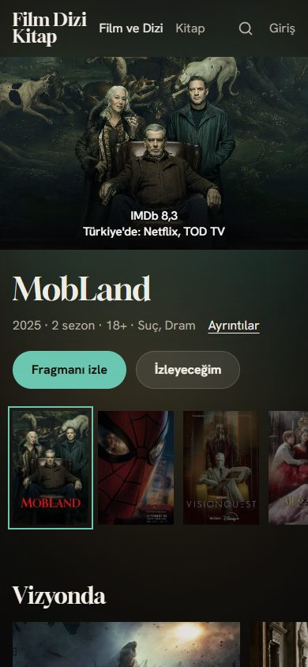
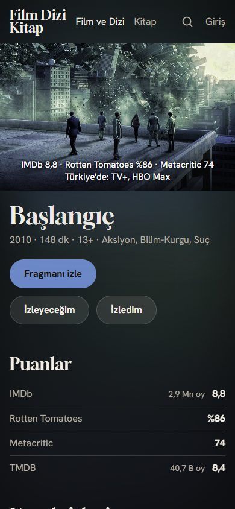
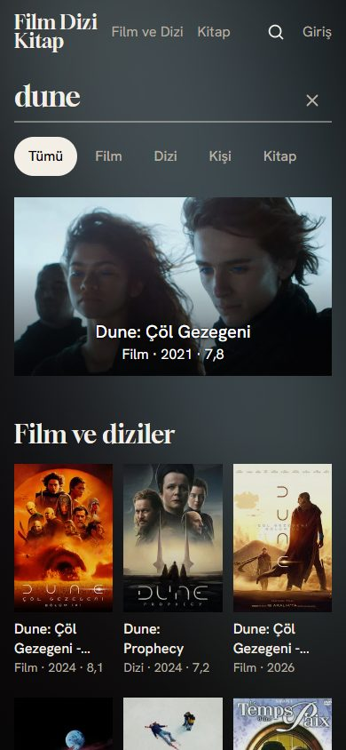
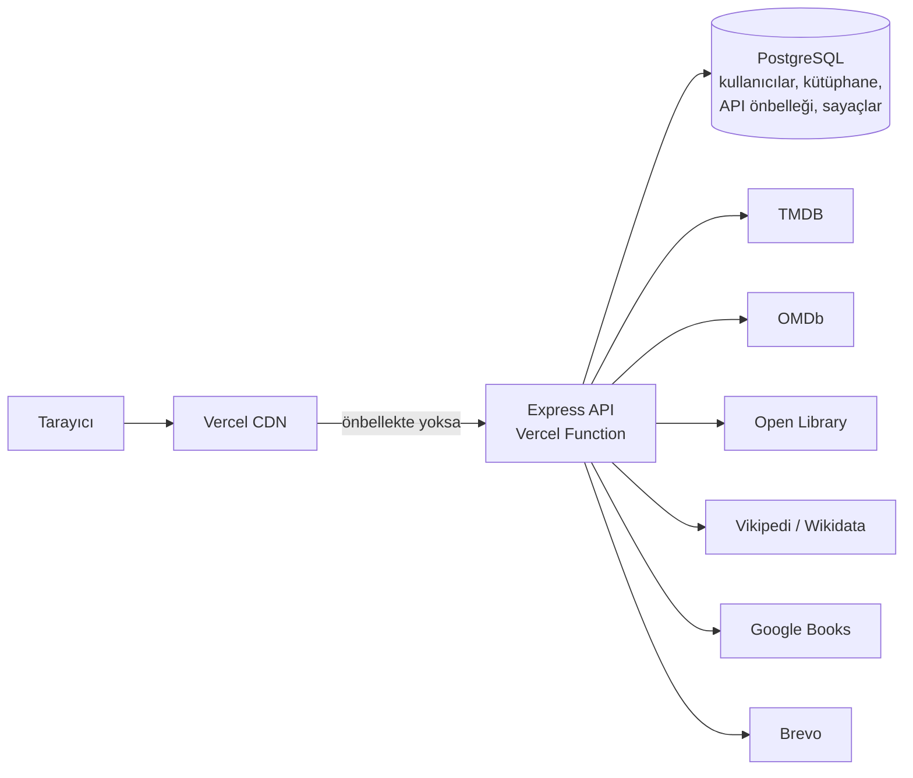

# Film Dizi Kitap

Film, dizi ve kitapları tek yerde keşfetmek ve takip etmek için Türkçe bir platform. Bir yapımın izlemeye değip değmediğini ve Türkiye'de nerede izlenebileceğini tek sayfada gösterir; izlediklerini ve okuduklarını kaydetmeni sağlar.

**Canlı:** [filmdizikitap.vercel.app](https://filmdizikitap.vercel.app)



## Özellikler

- **Tek aramada film, dizi, kişi ve kitap.**
- **Karar vermeyi kolaylaştıran detay sayfaları:**
  - IMDb, Rotten Tomatoes, Metacritic ve TMDB puanları bir arada;
  - Türkiye'de hangi platformda izlenebileceği;
  - fragman, oyuncular ve ekip, sezonlar, benzer yapımlar.
- **Kitaplar:**
  - Türkçe baskı ve kapaklar;
  - Türkçe Vikipedi'den açıklama;
  - yazar sayfaları ve Türk edebiyatı rafı.
- **Kütüphane:**
  - izleyeceğim / izledim, okuyacağım / okudum;
  - 1-10 puan;
  - herkese açık profil.
- **Hesap:** e-posta doğrulamalı kayıt. Gezinmek için giriş gerekmez; kaydetmek için doğrulanmış hesap gerekir.
- **Yapımı izleyen tasarım:** sayfanın vurgu rengi ve ışığı o anki yapımın görselinden okunur.
- **Mobil öncelikli, klavyeyle tam kullanılabilir arayüz.**

## Ekran görüntüleri

| Film detayı | Kitap detayı |
|---|---|
|  |  |

| Telefonda ana sayfa | Telefonda film | Telefonda arama |
|---|---|---|
|  |  |  |

## Teknoloji

| Katman | Teknoloji |
|---|---|
| Arayüz | React 19, TypeScript, Vite, Tailwind CSS, TanStack Query, React Router |
| Sunucu | Node.js, Express 5, TypeScript, Prisma 7, Zod |
| Veritabanı | PostgreSQL (Neon) |
| Yayın | Vercel (statik arayüz + tek sunucu fonksiyonu, Frankfurt) |
| E-posta | Brevo (HTTP API) |
| Test ve CI | Vitest, Supertest, Testing Library, Testcontainers, GitHub Actions |

## Mimari



Arayüz ve API aynı adreste çalışır (`/api`). Dış servislere yalnızca sunucu gider; API anahtarları tarayıcıya hiç ulaşmaz. Her kaynak için ayrı bir adaptör var. Ham yanıtlar Zod ile doğrulanır ve ortak bir içerik tipine (`movie | tv | book`) dönüştürülür; arayüz hangi kaynaktan geldiğini bilmez.

## Öne çıkan mühendislik kararları

**Dış veri ve önbellek**
- Dış yanıtlar PostgreSQL'de süreli olarak önbelleğe alınır.
  - Kaynak çökerse süresi dolmuş kopya gösterilir: eski veri, hata ekranından iyidir.
  - Aynı anda gelen aynı istekler tek bir dış isteğe iner.
- Herkese aynı yanıtlar (vitrin, detay, arama) CDN'de önbelleğe alınır; ikinci ziyaretçiden itibaren sunucuya hiç uğramaz.
- OMDb'nin ücretsiz kotası günde 1000 istek. Veritabanında tutulan günlük bir bütçe bu kotayı korur: bütçe dolarsa puanlar o gün boş kalır, sayfa çalışmaya devam eder.
- Yan veriler (puanlar, açıklama) gelmezse alan boş kalır; sayfa düşmez.

**Güvenlik**
- Oturum: JWT, `httpOnly`, `Secure`, `SameSite=Lax` cookie içinde (tarayıcıdaki kod okuyamaz). Şifreler bcrypt ile saklanır.
- CSRF'e karşı iki katman: `SameSite` cookie ve veri değiştiren isteklerde `Origin` / `Sec-Fetch-Site` kontrolü.
- Sayfa güvenlik başlıkları: içerik güvenlik politikası (CSP), başka sitelerin sayfayı çerçeveye gömmesine karşı koruma, `nosniff`.
- İstek sınırları:
  - sayaçlar PostgreSQL'de, bütün sunucu örnekleri için ortak;
  - giriş gerektiren uçlarda sınır IP'ye değil kişiye göre, çünkü aynı Wi-Fi'yi paylaşanlar tek IP'den görünür.
- E-posta doğrulama:
  - kod tek kullanımlık ve 24 saat geçerli; veritabanında yalnız SHA-256 özeti durur;
  - bağlantı adresi isteğin `Host` başlığından değil, sabit bir ayardan kurulur;
  - e-posta servislerinin bağlantıları önceden açmasına karşı, doğrulama bir düğmeyle onaylanır.
- Ortam değişkenleri açılışta Zod ile doğrulanır. CI her push'ta bağımlılık açığı taraması yapar.

**Test ve kalite**
- 227 otomatik test (165 sunucu, 62 arayüz).
- Veritabanı testleri taklit değil, Docker'daki gerçek PostgreSQL ile çalışır (Testcontainers). Her test dosyası şablondan kopyalanan kendi boş veritabanını alır.
- Arayüz testleri kullanıcı akışlarını sınar. Sunucu yalnızca `fetch` sınırında taklit edilir; veri katmanı ve hook'lar gerçek haliyle çalışır.
- Yeni bir test, koruduğu hata koda kasıtlı olarak geri konarak denenir; o zaman düşmüyorsa hiçbir şeyi korumuyordur.
- Eşzamanlılık:
  - 10 kullanıcının aynı yeni filmi aynı anda kaydettiği bir test var;
  - canlıda 10 eşzamanlı ziyaretçiyle ölçüldü: hata yok, CDN ısındıktan sonra ortanca yanıt 120 ms'nin altında.
- CI (GitHub Actions) her push'ta şu adımları çalıştırır: bağımlılık denetimi, biçim, lint, tip kontrolü, Prisma şema doğrulaması, testler ve derleme.

## Proje yapısı

```
api/                  Vercel fonksiyonu (derlenmiş sunucuyu çalıştırır)
client/               React arayüzü
  src/pages/          sayfalar
  src/features/       alana özel bileşenler ve hook'lar
  src/components/     ortak bileşenler
  src/lib/            API istemcisi ve yardımcılar
server/               Express API
  prisma/             veritabanı şeması ve migration'lar
  src/providers/      dış kaynak adaptörleri (tmdb, omdb, openlibrary, wikipedia, googlebooks)
  src/services/       iş kuralları (oturum, kütüphane, e-posta doğrulama...)
  src/routes/         API uçları
  src/middleware/     güvenlik, istek sınırı, önbellek başlıkları
docs/                 kurulum rehberi ve ekran görüntüleri
```

## Yerelde çalıştırma

Gereksinim: Node.js 24+. Gerekli ücretsiz hesaplar, API anahtarları ve `.env` kurulumu: [docs/SETUP.md](docs/SETUP.md).

```bash
git clone https://github.com/ahmetyasinaltun/FilmDiziKitap-Kesif-Platformu.git
cd FilmDiziKitap-Kesif-Platformu
npm install                    # bağımlılıklar + Prisma client
cp server/.env.example server/.env   # değerleri docs/SETUP.md'ye göre doldur
npm run check:env -w server    # .env'yi ve bütün bağlantıları değerleri göstermeden dener
npm run db:deploy -w server    # veritabanı tabloları
npm run dev                    # http://localhost:5173
```

Geliştirmede e-posta anahtarı boş bırakılabilir: doğrulama bağlantısı e-posta yerine terminale yazılır.

| Komut | Ne yapar |
|---|---|
| `npm test` | Bütün testler (veritabanı testleri Docker ister) |
| `npm run test:unit -w server` | Docker gerektirmeyen sunucu testleri |
| `npm run lint` / `npm run typecheck` | ESLint / TypeScript kontrolü |
| `npm run build` | Sunucu ve arayüz derlemesi |

## Proje geçmişi

İlk sürüm JavaScript ile yazılmıştı ve [`v1`](../../tree/v1) etiketinde duruyor. v2, TypeScript ile baştan tasarlandı ve v1'in sorunları bu tasarımda giderildi:
- localStorage'da 30 gün tutulan oturum;
- kütüphaneye eklenince açıklaması kaybolan yarım içerik kayıtları;
- girdi doğrulamasının ve istek sınırının olmaması;
- migration yerine her açılışta değiştirilen şema.

## Veri kaynakları

- Film, dizi ve kişi verileri: [TMDB](https://www.themoviedb.org/).
- Dış puanlar: [OMDb](https://www.omdbapi.com/).
- Nerede izlenir verisi: [JustWatch](https://www.justwatch.com/) (TMDB üzerinden).
- Kitap verileri: [Open Library](https://openlibrary.org/developers/api), [Google Books](https://developers.google.com/books).
- Türkçe kitap açıklamaları: [Vikipedi](https://tr.wikipedia.org/) (CC BY-SA 4.0; sitede kaynak bağlantısıyla gösterilir).

Bu ürün TMDB API'sini kullanır ancak TMDB tarafından onaylanmamış veya sertifikalandırılmamıştır.

---

## In English

**Film Dizi Kitap** ("Movies, Series, Books") is a Turkish discovery and tracking platform for movies, TV series and books. **Live:** [filmdizikitap.vercel.app](https://filmdizikitap.vercel.app)

- **Stack:** React 19, TypeScript, Vite, Tailwind CSS and TanStack Query on the front end; Node.js, Express 5, Prisma 7 and Zod on the back end. PostgreSQL (Neon), deployed on Vercel.
- **Data:** five external APIs behind per-provider adapters and one normalized content type: TMDB, OMDb, Open Library, Wikipedia/Wikidata and Google Books. Responses are cached in PostgreSQL (stale-if-error, request coalescing) and at the CDN.
- **Security:**
  - JWT in httpOnly cookies, bcrypt, two-layer CSRF protection and a Content Security Policy;
  - database-backed rate limits, per user where sign-in is required;
  - email verification with hashed single-use tokens.
- **Quality:**
  - 227 automated tests, with integration tests against a real PostgreSQL database (Testcontainers);
  - user-flow UI tests with Testing Library;
  - a GitHub Actions pipeline for audit, format, lint, type check, test and build.
